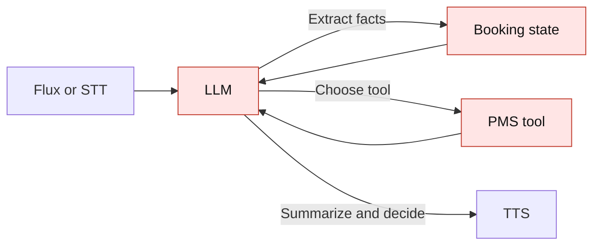
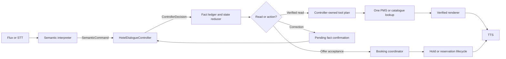
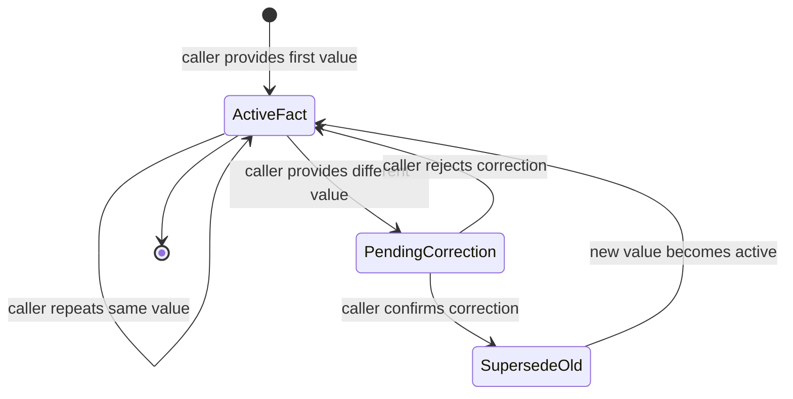
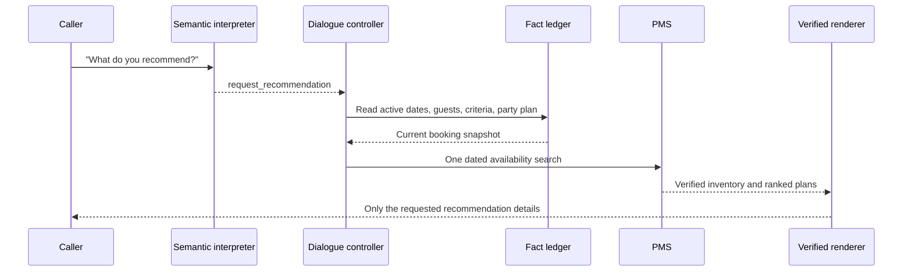
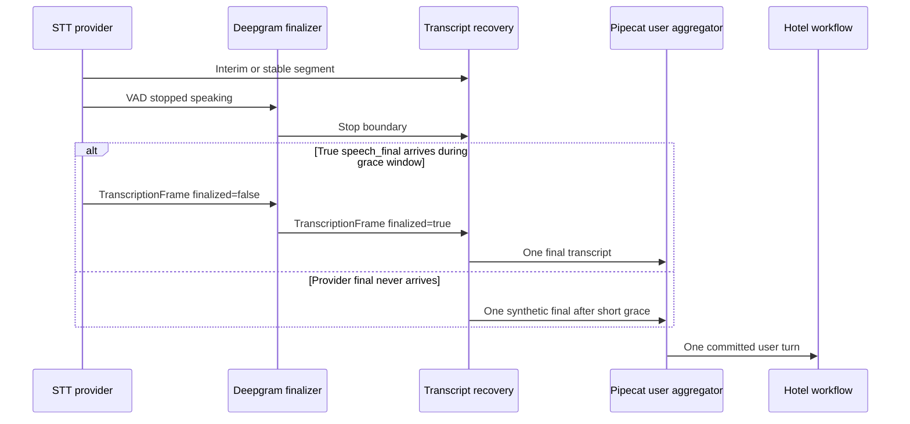

# Controller-Owned Hotel Dialogue Architecture

This document explains why the hotel voice flow is moving from an
LLM-controlled workflow to a controller-owned workflow.

## The problem we were fixing

Previously, one model response could perform too many jobs at once:

1. Understand the caller.
2. Extract booking values.
3. Decide whether a value was new or a correction.
4. Choose and execute a PMS tool.
5. Decide whether a recommendation was accepted.
6. Summarize the result for speech.

That created multiple competing authorities. A model could understand “six
guests,” while another part of the flow still used the old value of two. A
tool result could also be treated as if it were a caller decision. Short
answers such as “ji” were especially vulnerable because they were interpreted
without enough knowledge of the state being confirmed.

## Previous flow



The model, scalar booking fields, ledger, and PMS result could disagree about
which value was authoritative. The conversation service then needed defensive
checks and compatibility fallbacks in several places.

## Current flow



The important change is ownership:

| Concern | Owner now |
| --- | --- |
| Natural-language understanding | Semantic interpreter |
| Meaning of the turn in current state | `HotelDialogueController` |
| New value versus correction | `BookingFactLedger` |
| Persisted booking projection | Conversation service and ledger |
| Availability and catalogue truth | PMS/catalogue adapters |
| Spoken room facts, prices, and counts | Verified renderers |
| Hold and reservation side effects | Booking coordinator |

The LLM proposes meaning. It does not directly create a hold, overwrite a
confirmed fact, or invent room metadata.

## Correction lifecycle



Example:

```text
Turn 1: "Do guests"       -> guest_count=2, active
Turn 2: "Actually chhe"   -> guest_count=6, pending confirmation
Turn 3: "Haan ji"          -> 2 superseded, 6 active
```

The controller sees the pending-fact state before it sees a generic offer
acceptance. Therefore “haan ji” confirms the correction first; it cannot
accidentally create a hold for the old value.

## Recommendation lifecycle



Room-type metadata is read from the catalogue snapshot and PMS availability is
validated once for the requested dates. The renderer controls progressive
disclosure: a catalogue question returns room names, a feature question
returns matching features, and a recommendation returns the bounded offer.

## Why this is better

### Fewer conflicting authorities

There is one controller decision and one fact ledger. The LLM cannot silently
replace an active guest count or treat its own recommendation as a selection.

### Better correction behavior

Corrections are append-only and auditable. The old value remains in history,
but downstream code uses only the active value after confirmation.

### Lower latency for recommendations

The production interpreter parses one turn. Tool selection and execution are
local controller work, followed by one PMS lookup:

```text
one LLM parse + one PMS lookup + verified rendering
```

There is no second LLM summary call after a room lookup. The post-reduction
controller decision is in-process and does not add network latency.

### More reliable spoken facts

Prices, capacities, amenities, room counts, and availability come from
verified application data. The model may phrase the answer, but it is not the
source of truth for those values.

### Better testability

The controller is a pure module. Its decisions can be replayed with a small
state snapshot and a structured interpretation, without starting Pipecat,
calling an LLM, or connecting to a PMS.

## STT turn coalescing

The voice pipeline now treats a provider-stable transcript segment and an
utterance-final transcript as different events:



This prevents two opposite failures:

- A stable `TranscriptionFrame(finalized=False)` no longer blocks recovery.
- A late provider final no longer gets forwarded as an unseen suffix, which
  could create a second turn and repeat booking work.

The grace period is configurable through
`VOICE_INTERIM_TRANSCRIPT_FALLBACK_SECS`; it is a bounded recovery timer, not
an additional LLM call.

## Cleanup performed

- Removed the duplicate `HotelDialogueKernel` policy class.
- Removed the `dialogue_kernel` service alias.
- Routed service decisions through `HotelDialogueController`.
- Replaced controller-side question/comparison regexes with structured
  `SemanticCommand` and `dialogue_act` decisions.
- Removed `BookingPlan.may_update()` as a booking-authority check. The
  controller now receives caller-owned layout evidence from the domain
  reducer, while the no-interpreter fallback delegates to its isolated legacy
  coordinator.
- Retired model-owned `speech_opening` and `speech_final` fields from the
  hotel interpretation contract. The model's remaining `response` is only
  natural-language phrasing; verified room facts and booking outcomes come
  from application renderers.
- Controller-owned catalogue scopes and recommendation scopes are passed by
  the application, not accepted from model tool choices.
- Kept the interpreter's optional tool callback only for explicitly marked
  compatibility adapters and direct interpreter tests.
- Kept legacy language-rule mode only for test-only no-interpreter fixtures;
  production uses the semantic interpreter.

The remaining compatibility paths are isolated and do not run for the
production `OpenAIHotelTurnInterpreter`, which declares controller-owned tool
routing.

## Verification

The full hotel test suite passes after the cleanup. Ruff also passes for the
controller, conversation service, interpreter, and affected tests.

The remaining architectural work is to measure Flux's provider-owned turn
events separately from Nova/VAD recovery and remove compatibility adapters only
after production call traces show parity.
