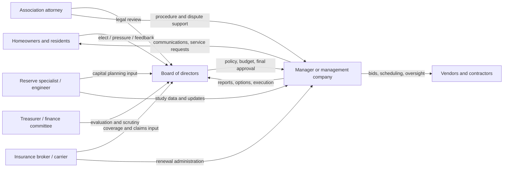
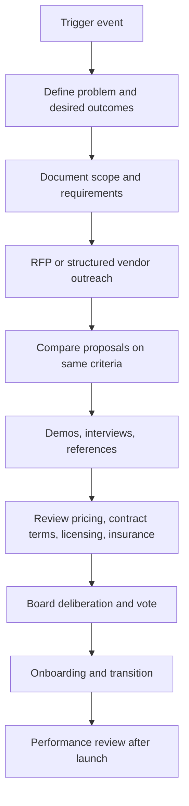

# Buyers, Procurement, and Decision-Making

## Buying Process and Procurement Criteria

HOA buying decisions are usually **board-controlled but manager-informed**. Boards set policy, approve major decisions, oversee the management company, and represent owners’ interests. Managers implement board decisions, administer day-to-day operations, and bring operational information to the board. Specialist advisers influence decisions when the purchase touches their domain: treasurers or finance committees on accounting and reserves, attorneys on contract and compliance risk, reserve specialists on capital planning, and insurance professionals on coverage and carrier issues. citeturn21search19turn21search20turn25view0turn7search4

A common procurement process for management companies and operational vendor solutions is broadly similar: a trigger event occurs; the board defines requirements; an RFP or structured scope is issued; proposals are compared; finalists are interviewed or demoed; credentials, references, licences, insurance, and contract terms are reviewed; and the board votes before onboarding. CAI’s selection guide explicitly references determining specifications, creating bid packages, identifying candidates, interviewing, analysing proposals, and managing transitions. RealManage’s RFP guidance adds technology requirements, staffing model, pricing, licensing, and insurance; Buildium’s software-buying guide adds board/resident needs, data access, communication preferences, scalability, and support/training. citeturn8view1turn38view1turn38view0

The cheapest offer is rarely enough on its own. CAI and industry RFP guidance emphasise clear scoping because otherwise boards cannot compare bids like-for-like. RealManage’s public RFP guide says boards should evaluate **experience, staffing, technology, pricing models, contract terms, communication style, financial controls, compliance practices, and cultural fit**, while Buildium’s buyer guide emphasises **board and owner needs, report access, mobile access, communication, scalability, data exports, uptime, onboarding, and support**. CAMICB’s CMCA materials also show that credentialing matters because boards and employers seek qualified professionals to manage communities. citeturn8view1turn38view1turn38view0turn39view1

A concise buyer-criteria frame for selling vendor solutions into this channel is below.

| Procurement criterion | Why boards and managers care | What a winning vendor should prove | Evidence |
|---|---|---|---|
| Clear fit to community needs | Communities differ by size, amenities, age, governance structure, and resident expectations | Community-specific workflow mapping, not generic features | citeturn38view1turn8view1 |
| Transparency and reporting | Boards must govern by exception, not by guesswork | Board-ready dashboards, exports, audit trails, role-based access | citeturn38view0turn38view1 |
| Communication quality | Resident dissatisfaction quickly becomes a board issue | Status visibility, templated communications, escalation paths, owner self-service | citeturn16view0turn18view1turn38view0 |
| Service and staffing model | Boards fear buying tools that still leave workload on volunteers | Explicit ownership of setup, support, onboarding, and issue resolution | citeturn38view1turn34view3 |
| Compliance and risk control | Record-keeping, elections, collections, insurance, and reserve processes are sensitive | Deadline management, document retention, policy consistency, security and continuity controls | citeturn22view1turn22view3turn38view0 |
| References and credibility | Boards are conservative because bad transitions are painful | Similar-community references, implementation history, credentialed staff, proof of outcomes | citeturn38view1turn39view1 |
| Total cost of ownership | Fee-sensitive communities punish hidden costs | Clear base fees, add-ons, migration effort, support costs, and termination terms | citeturn38view1turn14view0 |

The most important sales lesson is that purchases are often made by **multi-party consensus**, not by a single operational buyer. A solution that satisfies only the manager but not the treasurer, board president, or attorney will stall. The strongest commercial position is usually one that gives each stakeholder something tangible: easier execution for managers, better oversight for boards, clearer records for counsel, and less friction for residents. citeturn21search19turn21search20turn38view0turn38view1
